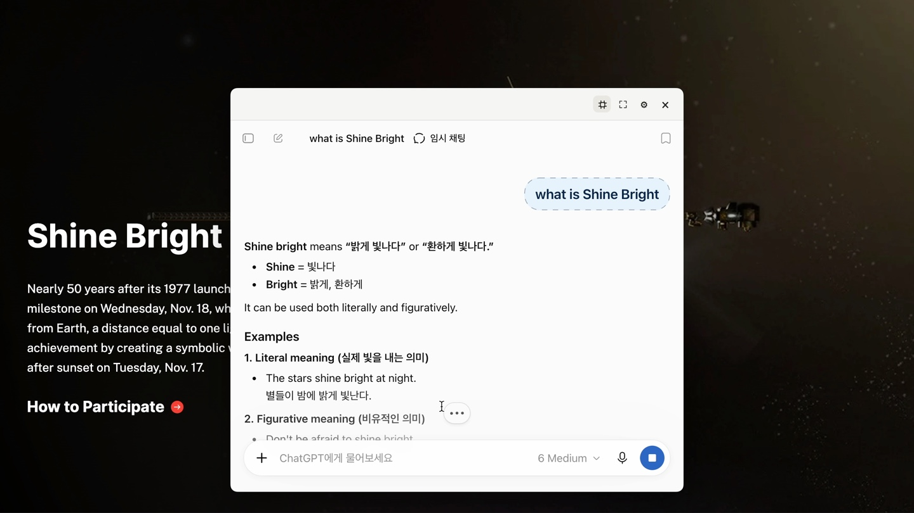

# Just Chat

**Quick ChatGPT for your desktop.**

Open a compact ChatGPT window with a shortcut, ask a question, then keep talking in a larger view. Just Chat is built with Electron for macOS and Windows and uses ChatGPT's website and your ChatGPT account.

<p align="center">
  <a href="docs/artifacts/readme/quick-chat-demo.mp4"></a>
  <br />
  <a href="docs/artifacts/readme/quick-chat-demo.mp4">Watch the full-resolution demo (MP4)</a>
</p>

<p align="center">
  
  <br />
  <sub>Keep the page you're reading in view while you chat.</sub>
</p>

## Why I built it

I used GPT Classic for its quick, lightweight chat window. As it became heavier and support was expected to end, I wanted to keep that fast way of reaching ChatGPT and make it available on both macOS and Windows.

## What it does

- **Quick Chat:** Open a small, always-on-top window from anywhere. It appears on the display under your pointer and focuses the message box.
- **Room to talk:** The empty window stays compact and grows when a conversation starts. Switch between Quick Chat and a larger view, or fill the current display.
- **Keyboard controls:** Use ChatGPT's own search shortcut, start a temporary chat, adjust the window, and open Settings from the keyboard.
- **Appearance:** Follow the system theme or choose Light or Dark. Adjust window opacity and ChatGPT page zoom in Settings.
- **Keep your place:** The app remembers your window size and ChatGPT session. An empty Quick Chat hides when you switch to another app.

### Shortcuts

| Action | macOS | Windows | Scope |
|---|---|---|---|
| Show or hide Just Chat | `Option+Space` | `Ctrl+Shift+Space` | Global |
| Quick Chat / larger view | `Command+Shift+E` | `Ctrl+Shift+E` | Just Chat focused |
| Fill / restore display | `Command+Shift+F` | `Ctrl+Shift+F` | Just Chat focused |
| Open Settings | `Command+,` | `Ctrl+,` | Just Chat focused |
| Start a temporary chat | `Command+Shift+N` | `Ctrl+Shift+N` | Just Chat focused |
| Search conversations | `Command+K` | `Ctrl+K` | ChatGPT built-in |
| Zoom ChatGPT page | `Command+-`, `Command++`, `Command+0` | `Ctrl+-`, `Ctrl++`, `Ctrl+0` | ChatGPT page |
| Hide Just Chat | `Escape` (`Command+W` also works) | `Escape` | Just Chat focused |

Only Show or Hide is global by default. Change app shortcuts in Settings. ChatGPT's `Command+K` / `Ctrl+K` search remains ChatGPT's own shortcut and is not remapped by Just Chat.

## Install

No public installer has been published yet. After the first release is published, installers will be available from [GitHub Releases](https://github.com/MyeoungDev/JustChat/releases). Initial build targets are macOS on Apple Silicon and Windows x64. macOS builds use an ad-hoc signature until Developer ID signing and notarization are configured; Windows builds have no publisher signature. The operating system may show an unidentified-developer or unknown-publisher warning. Review the release notes and checksums before installing.

Electron 45 requires macOS 13 or newer and Windows 10 or newer. These are upstream runtime minimums; this project has not yet completed manual installation testing on every supported OS version. See [release and installation notes](docs/RELEASE.md) for current build and verification status.

## Run from source

To run the development app locally:

```sh
git clone https://github.com/MyeoungDev/JustChat.git
cd JustChat
pnpm install
pnpm dev
```

### Requirements

- macOS or Windows
- Node.js 22.13 or newer
- pnpm 11.4.0 (the version pinned by this repository)

## Settings

Settings include:

- Global show/hide and focused window shortcuts
- System, Light, and Dark themes
- Always-on-top behavior, opacity, and ChatGPT page zoom
- Whether to reload ChatGPT after the window has been hidden for a while
- A generic system notification when a ChatGPT reply finishes while the window is hidden
- ChatGPT sign out and local website-data clearing

The default page zoom is calibrated to the previous full-size ChatGPT view. Temporary Chat is started through ChatGPT's own control when available.

Hidden-reply notifications are enabled by default and can be disabled in Settings. Notification delivery depends on operating-system permissions and app signing; Just Chat must remain running, and the notification does not include chat content.

## Limitations

- Just Chat is a desktop window around ChatGPT's website, not a separate ChatGPT client or model API.
- Sign-in, network challenges, and some interactions depend on ChatGPT and may change with its website.
- The ChatGPT integration is experimental. The app cannot guarantee that every website change will keep shortcuts and automatic window sizing working.
- The release workflow creates draft installers for manual review. Developer ID/Authenticode signing and macOS notarization are not configured yet; macOS packages are ad-hoc signed so Apple Silicon can validate the patched Electron binary.
- Just Chat does not install updates automatically. Check GitHub Releases and install a newer version manually; app data is kept when the Windows app is uninstalled.

## Support and security

- Read [known release limitations and install guidance](docs/RELEASE.md).
- Report bugs through [GitHub Issues](https://github.com/MyeoungDev/JustChat/issues). Do not include prompts, replies, cookies, or account details.
- See [SECURITY.md](SECURITY.md) for private vulnerability reporting and [PRIVACY.md](PRIVACY.md) for local data details.
- See [CONTRIBUTING.md](CONTRIBUTING.md) before opening a pull request.

## Privacy

- ChatGPT signs in to a persistent website profile used only by Just Chat; it does not share cookies with Chrome or Safari.
- Just Chat does not copy conversation text into its settings. It stores the active conversation path so it can reopen the chat after a restart.
- Signing out in Settings clears Just Chat's local ChatGPT website data. It does not delete conversations from your ChatGPT account.

## Development checks

```sh
pnpm typecheck
pnpm test
pnpm build
```

More detail: [verification checklist](docs/verification.md), [security review](docs/SECURITY_REVIEW.md), and [architecture review](docs/architecture-review.md).

## License

[MIT](LICENSE)

## Not affiliated with OpenAI

Just Chat is an independent open-source project and is not affiliated with, endorsed by, or sponsored by OpenAI. ChatGPT is a trademark of OpenAI, used here only to identify the service Just Chat works with.
